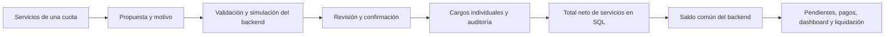

# Servicios integrados a cuotas y cobros pendientes

Fecha: 4 de noviembre de 2026. Base: `a9b247a` (main y origin/main sincronizados al comenzar). Implementación local, sin commit, push, despliegue ni modificación de datos reales.

## Resultado y arquitectura

Cristian puede abrir Servicios desde cualquier cuota de Cobros pendientes, cargar uno o varios conceptos y revisar su efecto antes de confirmarlos. Cada servicio conserva su importe original, condonación, estado, origen, referencia y modificaciones. La condonación no utiliza el descuento general de la cuota.

Antes, Servicios era principalmente un registro de gastos del propietario/inmobiliaria. Sigue funcionando así. Los cargos al inquilino tienen entidades y operaciones separadas; registrar una factura pagada no genera automáticamente deuda ni ingreso. Puede vincularse un gasto compatible para consulta y trazabilidad.

El recorrido implementado es:



No se cambia el canon contractual, la base IPC, los índices, sus fórmulas ni la fuente INDEC. La conciliación sigue utilizando su motor original; lee el nuevo componente del saldo desde `balance()`. Únicamente se añadió una guarda para no conciliar períodos marcados como cerrados.

## Migración 015 y diseño relacional

Nueva migración aditiva: `database/migrations/015_installment_services.sql`.

| Entidad | Responsabilidad |
| --- | --- |
| `installment_services` | Cargo concreto: UUID, cuota, regla opcional, categoría libre, descripción, original NUMERIC(14,2), condonación NUMERIC(14,2), moneda, estado, condición contractual declarada, referencia, gasto relacionado, observaciones y fechas. |
| `service_rules` | Configuración mensual de un contrato: concepto, importe fijo o variable, rango de vigencia, moneda y referencia de responsabilidad. Se conserva separada de los cargos emitidos. |
| `service_operations` | Registro persistente de operación e idempotencia: UUID de solicitud, propuesta firmada por hash, resultado, motivo, actor y fecha. |
| `audit_log` | Historial de cada operación con cargos anteriores/propuestos, impacto por cuota, pagos conservados y decisión de reapertura cuando corresponda. |
| `installments.services_amount` | Proyección SQL del total de cargos Confirmados menos condonaciones. Un trigger la actualiza en la misma transacción; no es un importe libre editable por el cliente. |
| `installments.financial_closed_at` | Marcador de cierre contable. Bloquea cargos, pagos, edición de importes y conciliación. No se infiere que Pagado signifique cerrado. |
| `payment_requests` | Idempotencia persistente para pagos individuales/distribuidos enviados por la interfaz nueva. |

Contrato, propiedad y período del cargo se obtienen mediante la cuota. No se duplican esas identidades. El importe neto y la etiqueta Perdonado/Condonado parcialmente se derivan del estado e importes del cargo.

Los vínculos económicos nuevos utilizan referencias restrictivas, sin eliminación en cascada de cargos, reglas o gastos relacionados. Un contrato con servicios no se elimina físicamente desde la aplicación: la vista previa explica el bloqueo y permite conservarlo mediante su ciclo de vida.

La migración no reescribe pagos, cánones ni gastos, y no convierte los `recurring_charges` que existían en importaciones. Las cuotas anteriores reciben servicios cero y cierre nulo, manteniendo su saldo.

## Cargos únicos, recurrentes y variables

- **Único:** afecta solo la cuota seleccionada.
- **Rango:** se seleccionan mes inicial y final con el selector personalizado, dentro de la vigencia. Se revisan todas las cuotas afectadas antes de confirmar.
- **Futuras del contrato:** desde la cuota seleccionada hasta el final del contrato, sobre cuotas existentes. No inventa ni extiende un cronograma.
- **Fijo:** configura el importe y crea un cargo independiente en cada mes; puede confirmarse la aplicación del rango o conservarse como borrador.
- **Variable:** registra la configuración mensual y crea borradores con importe nulo, aunque se haya enviado un valor. Cada mes debe completarse y confirmarse individualmente.

Cada regla/cuota tiene una restricción de unicidad. Generar períodos faltantes omite los ya existentes, incluidos cargos anulados: una repetición no vuelve a cobrar una obligación retirada. Cambiar un servicio de un mes no modifica otros meses ni la regla histórica.

No hay un proceso que repita importes indefinidamente ni generación automática fuera de las cuotas existentes. Las reglas no se trasladan a una renovación. Contratos finalizados, rescindidos, renovados, anulados, archivados o desactivados no generan cargos nuevos ni admiten aumentos de obligación por restauración/edición. Conservan consulta y reducciones auditadas de los cargos históricos.

Las cuotas con servicios superpuestas a una renovación se conservan, en vez de sustituirse silenciosamente. No se copian cargos ni recurrencias al nuevo contrato.

## Confirmación contractual y borradores

La categoría de un servicio no determina quién debe pagarlo. Se admiten Expensas, Agua, Electricidad, Gas, Internet, ABL/tasa municipal y conceptos personalizados.

Para confirmar un cargo se exige importe, moneda compatible, declaración explícita del operador y referencia a la condición contractual aplicable. Sin esos datos queda como borrador y no es exigible. La referencia es texto auditado: no constituye una interpretación jurídica automática ni una verificación del contenido del PDF. La revisión corresponde al operador.

La protección de condiciones contractuales y la rectificación documentada siguen separadas de este circuito. Un servicio no autoriza cambiar el contrato.

## Condonación, restauración y corrección

En el modal se muestran original, perdonado y neto de cada cargo, además de los totales de cargos confirmados. Los borradores y anulados no forman parte del total exigible.

Perdonar requiere motivo y un importe total de condonación positivo que no supere el original. Se puede perdonar todo o parte. El valor indicado reemplaza la condonación anterior; no se acumula nuevamente sobre ella. Otros servicios y el descuento general permanecen intactos.

Restaurar pone la condonación del servicio en cero mediante otra operación revisada y auditada. Editar permite corregir el original, descripción o respaldo; si el nuevo original es inferior a lo ya condonado, se bloquea hasta revisar/restaurar esa condonación en una operación separada. Retirar realiza una anulación lógica irreversible de ese cargo, preservando pagos e historial.

Toda operación, incluso sobre una cuota sin pagos, sigue el mismo circuito: motivo → simulación sin escrituras → revisión → confirmación. El historial muestra actor disponible, fecha, valores anteriores y nuevos, condonaciones, estado y saldo. Cada cuota consulta únicamente sus cambios dentro de las operaciones recurrentes.

## Saldo, estados y pagos

El backend mantiene la interpretación existente:

```text
Total exigible = alquiler aplicado + IVA + punitorios
                + servicios confirmados netos − descuento general registrado
Pagos computados = SUM(payments.amount) + manual_partial_amount
Saldo firmado = total exigible − pagos computados
Debe = máximo entre saldo firmado y cero
Crédito = máximo entre −saldo firmado y cero
```

`manual_partial_amount` es un componente adicional ya existente de pagos computados; no se vuelve a restar del total. El servicio no se incorpora a IVA, canon, índices ni al cálculo porcentual de descuentos. Los importes de descuento ya registrados conservan su semántica.

El cálculo usa aritmética decimal con BigInt en centavos y NUMERIC en SQL. Se conservan los tipos numéricos públicos anteriores de Cobros pendientes al serializar la respuesta. Los nuevos detalles financieros utilizan decimales como texto. El frontend muestra totales recibidos; no reconstruye el saldo de servicios.

El total SQL se lee desde pendientes, pagos, dashboard y conciliación. `paymentStatus()` usa el saldo integrado: Pendiente/Parcial/Pagado y conservación de Vencido/Sustituido según el modelo existente. La interfaz mantiene la indicación de vencimiento por fecha. Los índices aún pendientes conservan su tratamiento provisional.

Agregar un cargo a una cuota pagada muestra el saldo anterior y nuevo, señala que reabre una obligación y exige confirmación. No borra ni reemplaza la transferencia original. Una reducción posterior a un cobro puede producir crédito, mostrado como saldo a favor; no transfiere ese crédito a otros períodos ni devuelve dinero automáticamente.

Los pagos individuales y distribuidos comparten el bloqueo financiero de escritura con servicios y conciliación. La distribución ahora es una única transacción: si falla una cuota, se revierten todas sus imputaciones. Se calcula con el saldo real y centavos, sin mezclar monedas.

La interfaz envía una clave por pago/operación y reutiliza esa clave ante reintentos de aplicación. El servidor devuelve el resultado anterior para una solicitud idéntica y rechaza su reutilización con otro contenido. No se duplican transferencias ni operaciones auditadas por doble confirmación. Los clientes antiguos sin clave mantienen compatibilidad y deben evitar reenvíos ciegos.

## Seguridad y consistencia

Las validaciones del servidor incluyen importes no negativos con hasta dos decimales, condonación acotada al original, monedas ARS/USD coincidentes con cuota y contrato, existencia y pertenencia de IDs, propiedad correcta, alcance contractual y referencia para confirmar responsabilidad.

Una vista previa lleva un token HMAC propio que vence en 15 minutos. Vincula propuesta, motivo, contrato, cuotas, cargos, reglas y pagos. Si cambia un pago, importe, estado, evidencia declarada o propuesta, la aplicación exige revisar de nuevo. No se usan tokens de IPC o rectificación como autorización de servicios.

Aplicar adquiere el bloqueo financiero común y bloqueos de filas, verifica el snapshot y escribe cargos, proyección, estado, auditoría e idempotencia en una sola transacción. Un error revierte todo. GET de detalle usa un snapshot consistente de solo lectura.

No hay borrado físico por API de cargos. Las cuotas sustituidas o cerradas rechazan cambios y pagos. No existe un bypass de cierre desde la interfaz. Como no había un módulo de cierres contables, esta entrega incorpora el marcador y la guarda; el procedimiento de cierre/reapertura autorizado queda para la integración contable correspondiente.

## Interfaz, liquidación y gastos existentes

La nueva columna Servicios aparece después de IVA, con importe pulsable y lápiz. Reutiliza Modal, componentes, logo, paleta y navegación existentes. El modal también es accesible desde Contratos → Servicios por cuota para consultar cuotas ya pagadas. No utiliza alert ni prompt.

Se conservan filtros combinados de mes/contrato, selección al actualizar, una sola tabla agrupada por `installments.period`, subtotales separados por moneda y todas las acciones de cobro anteriores, incluido el detalle IPC pulsando el alquiler.

PaymentModal incorpora Servicios netos al resumen y toma el Debe autoritativo. TenantLiquidationModal consulta saldos y cargos vigentes y muestra alquiler, IVA, cada servicio, condonaciones, subtotal informativo de servicios, punitorios, descuento general, pagos y saldo/crédito. Mantiene Imprimir / guardar PDF y bloquea la impresión si no puede consultar el detalle. No crea una factura fiscal ni altera PDFs existentes.

El dashboard muestra el total exigible con servicios y el saldo real de cuotas pendientes. Los indicadores/gráfico principales son ARS y los totales USD se informan por separado. Los gastos existentes también presentan sus totales por moneda. Cobros históricos continúa mostrando dinero efectivamente recibido: crear un cargo no agrega un ingreso al libro contable ni una transferencia.

## Archivos

| Archivo | Cambio |
| --- | --- |
| `database/migrations/015_installment_services.sql` | Tablas, proyección SQL y marcador de cierre, sin conversión histórica. |
| `backend/src/modules/services/index.js` | Detalles consistentes, validación, simulación firmada, operaciones transaccionales y auditoría. |
| `backend/src/lib/money.js` | Integra servicios al saldo común; conserva aritmética decimal y pagos. |
| `backend/src/app.js` | Rutas, totales, pagos atómicos/idempotentes, integración dashboard y guardas de renovación/eliminación/cierre. |
| `backend/src/modules/rent/index.js` | Guarda de períodos cerrados antes de conciliar; sin cambiar fórmulas IPC. |
| `frontend/src/components/InstallmentServicesModal.jsx` | Gestión por cargo, recurrencias, impacto, confirmación e historial. |
| `frontend/src/components/TenantLiquidationModal.jsx` | Extracción del modal existente con desglose de servicios y consulta financiera vigente. |
| `frontend/src/components/PaymentModal.jsx` | Resumen de servicios, montos decimales y clave de reintento. |
| `frontend/src/components/MonthYearPicker.jsx` | Etiquetas reutilizables y posibilidad de exigir un período para rangos, conservando el filtro anterior. |
| `frontend/src/pages/ResourcePage.jsx` | Columna y accesos, total de edición compatible, separación de gastos/cargos y monedas. |
| `frontend/src/pages/DashboardPage.jsx` | Saldo autoritativo y presentación por moneda. |
| `frontend/src/styles.css` | Estilos localizados del modal, tabla y columna. |
| `tests/services.test.js` | 28 casos de integración/regresión y actualización de esquema 014. |
| `tests/services-browser.test.js` | Recorridos completos Chrome/WebKit y capturas. |
| `tests/run-isolated.js`, `package.json` | Integración en suites completas. |
| `docs/API.md` | Endpoints, payloads, estados, pagos e idempotencia. |
| `docs/SERVICIOS_INTEGRADOS_CUOTAS.md` | Este informe. |

Sin dependencias nuevas ni cambios al lockfile. No se modifican migraciones anteriores, gestión documental/PDF, protección o rectificación contractual, WhatsApp, logo, fuente INDEC, índices oficiales, recibos fiscales ni Banco Nación.

## Pruebas y evidencia

| Comprobación | Resultado |
| --- | --- |
| `pnpm test` | 136 aprobadas, 0 fallos: 108 anteriores + 28 nuevas. |
| `pnpm check` | Sintaxis, comprobaciones existentes y compilación aprobadas. |
| `UX_BROWSERS=chrome,webkit pnpm test:browser` | 8 recorridos aprobados, 0 fallos: 6 anteriores + servicios en ambos navegadores. |
| `git diff --check` | Sin errores. |

Se ejecutan con PostgreSQL temporal mediante `tests/run-isolated.js`; el runner crea y destruye un cluster independiente. Se indicaron `PG_BIN=/opt/homebrew/opt/postgresql@17/bin` y la ruta local de Playwright mediante `PLAYWRIGHT_CLI`.

Los nuevos casos cubren altas y categorías, múltiples cargos, original/corrección, condonación total y parcial, restauración/anulación, aislamiento entre cargos, borradores y confirmación, validación de IDs/moneda/importes, pagos parciales/completos/manuales, crédito/reapertura, recurrencias fijas/variables sin duplicación, estados contractuales, gastos separados/vinculados, cuotas sustituidas/cerradas, concurrencia e idempotencia, tokens obsoletos/manipulados, rollback de cargos y distribución, subtotales/monedas, archivo/eliminación, IPC independiente, renovación y dashboard.

La prueba de actualización crea un esquema 001–014 con cuota, IVA, punitorios, descuento, pago manual, transferencia, gasto de servicio y cargo recurrente antiguo. Aplica 015 allí y verifica que el saldo, pagos y movimientos permanecen idénticos, con cero servicios nuevos. No usa la base real.

El recorrido de navegador realiza todas las operaciones principales desde la interfaz, registra pago parcial y completo, consulta la liquidación, configura una recurrencia variable, agrega un cargo después del pago, verifica la advertencia de reapertura y anula otro cargo sin eliminar dinero recibido. Comprueba conservación de canon e historial IPC en PostgreSQL, filtros/subtotales y ausencia de errores de consola.

Escritorio: 1440 × 1000. Móvil: 390 × 844. Chrome y WebKit se probaron en esta Mac; Windows, Edge y Safari nativo no se ejecutaron por separado.

Evidencias locales en `tmp/services-verification/chrome/` y `tmp/services-verification/webkit/`:

- `services-desktop.png`: cargos, importes y auditoría.
- `pending-services-desktop.png`: columna y subtotal mensual.
- `tenant-liquidation.png`: servicios individuales, condonación y saldo.
- `services-mobile.png`, `pending-services-mobile.png`: presentación móvil con desplazamiento dentro de las tablas.
- `paid-installment-reopening.png`: aviso y confirmación de obligación posterior al pago.
- `evidence.json`: resultados y preservación de importes.

Logs finales: `tmp/services-verification/tests.log`, `browser.log` y `check.log`. Los artefactos están fuera del control de versiones.

## Límites y riesgos pendientes

- La aplicación no dispone de sesiones de usuario autenticadas. La auditoría registra al operador local asignado por el servidor. Los permisos por rol requieren una futura integración de autenticación.
- La obligación del inquilino y la referencia de evidencia son revisadas por el operador; no se certifican automáticamente cláusulas ni documentos.
- Los tokens son propios de un proceso. Reiniciar invalida simulaciones pendientes. Antes de desplegar múltiples procesos hay que compartir de forma segura su mecanismo de firma o dirigir cada simulación/aplicación al mismo proceso.
- No hay automatismo que invente importes variables, trasladado de servicios a renovaciones, importación masiva de facturas, asignación contable por concepto, devolución de créditos ni conversión entre monedas.
- No se implementó un circuito general de cierre/reapertura; las cuotas marcadas cerradas quedan bloqueadas para revisión contable externa al flujo.
- Un operador debe revisar servicios superpuestos conservados por una renovación para evitar cobrar dos veces una obligación del mismo período en contratos distintos. No se copian de forma automática.
- La impresión conserva el mecanismo del navegador y requiere permitir la ventana de impresión; no genera facturas fiscales.

## Despliegue controlado y rollback lógico

1. Detener la instalación y cualquier watcher antes de actualizar. Hacer respaldo completo de PostgreSQL y documentos según el procedimiento habitual.
2. Revisar el diff y la migración 015 en un entorno de prueba con copia controlada; cotejar saldos previos, en especial cuotas con pagos manuales y transferencias.
3. Instalar con lockfile y ejecutar las comprobaciones anteriores. Esta entrega no añade dependencias.
4. Con autorización para el despliegue, aplicar la migración explícitamente con la conexión correcta. El script exige `DATABASE_URL`; por ejemplo, `node --env-file=.env backend/scripts/migrate.js`. Verificar 015 en `schema_migrations` antes de iniciar.
5. Iniciar backend y frontend de la misma versión con `AUTO_MIGRATE=false`. El valor exportado en el entorno prevalece sobre el archivo `.env`; no dejar que un watcher aplique migraciones no revisadas.
6. Consultar cartera y saldos sin cargar cargos reales de prueba. Una primera carga real debe cotejar obligación, período y comprobante, revisar simulación y confirmar expresamente.
7. Revisar pendientes, resumen de pago, liquidación y dashboard. Una cuota sin servicios debe conservar su saldo anterior.

Rollback lógico: mantener el esquema y la versión que comprende servicios. Corregir o anular cargos mediante operaciones auditadas con motivo y revisión de pagos/créditos. No borrar tablas, cargos, pagos ni auditoría. Volver a una versión anterior que ignore `services_amount` mostraría saldos incompletos y no es un rollback financiero válido. Si se requiere restauración de backup, debe ser coordinada para no perder transferencias ni operaciones posteriores.

**No se aplicaron migraciones, cargos ni pagos en la base real. No se modificaron archivos PDF del usuario, `.env`, datos históricos reales ni privacidad del repositorio. No se realizó commit ni push.**
